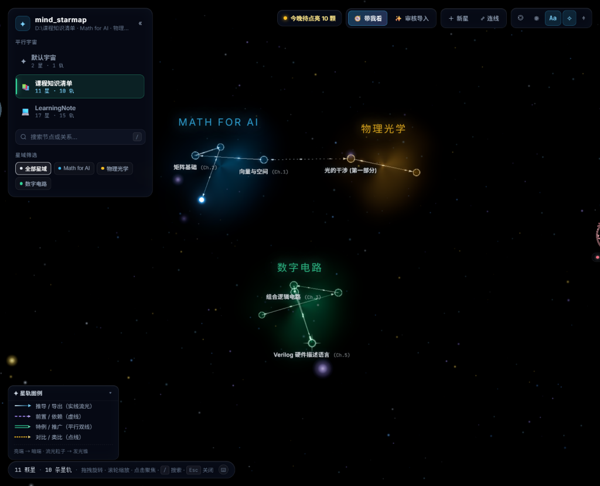
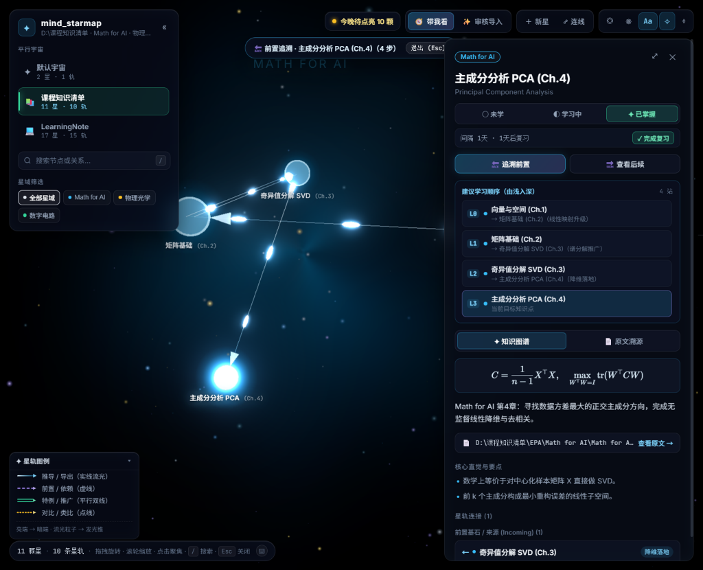
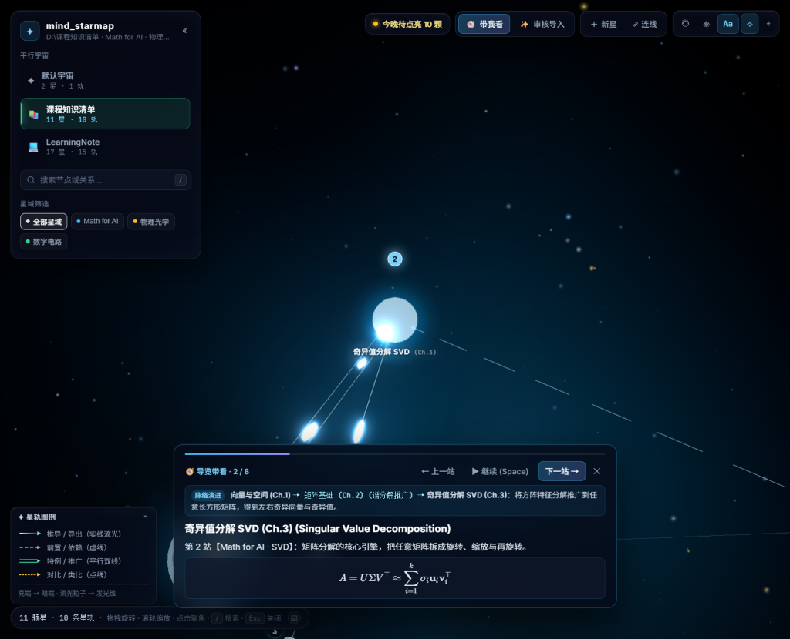
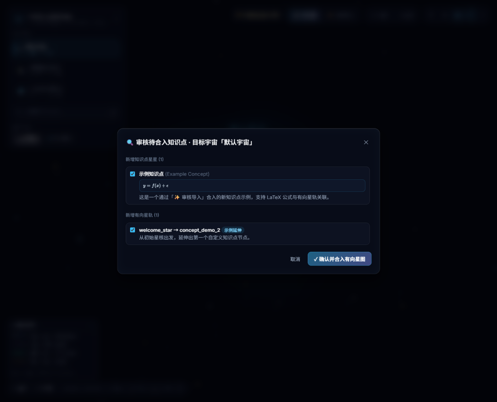

# ✦ mind_starmap

> 仿照 Obsidian 思维图谱的 **3D 有向知识星空图** —— 支持多平行宇宙切换、跨宇宙 3D 虫洞跃迁、KaTeX 公式渲染，以及内置 AI Skill（边学边记审核合入 + PPT/PDF/论文一键成图并带看）。

## 💡 你是否也遇到过这些学习痛点？

- **“俄罗斯套娃”式回溯复习**：学一个新概念时，发现卡在了前置知识上；回头翻前置知识，又发现它还依赖更早的概念——光是在笔记、教材和网页之间来回翻找，就耗掉了大半精力。
- **知识点是散的，连不成网**：一整章学完、公式背了不少，但合上书却说不清它们之间谁推导了谁、谁是谁的特例或推广。
- **面对新论文 / 厚 PPT 无从下手**：拿到一篇硬核论文或几十页的课件，通篇术语与公式堆在一起，不知道作者为什么这么设计，也抓不住从“研究痛点”到“核心方法”的主线脉络。

**`mind_starmap` 就是为此而生的：**\
用 **有向星轨** 把“前置依赖 → 后续推导”一眼看穿，用 **平行宇宙与虫洞** 把跨学科概念直接打通，再配合内置的 **AI Skill**，把你的零散笔记和整篇论文变成一张**能看、能点、还能带着你飞一遍**的 3D 知识星空。



---

## ✨ 核心特性

- **有向星轨 & 关系类型编码**：
  - 每条星轨以**起点亮 → 终点暗**的色彩渐变、`InstancedMesh` 沿边高速流光粒子与终点发光锥直观指明 `前置来源 → 后续推导` 方向；悬停星轨叠加高亮光束并点亮两端星点。
  - 按 `relation` 关键词自动编码 4 类线型（左下角附可折叠图例）：**推导/导出**（实线流光）、**前置/依赖**（虚线）、**特例/推广**（平行双线）、**对比/类比**（点线）。
- **前置追溯 & 后续推导模式（打破套娃回溯）**：
  - 选中任意知识点后，可在右侧抽屉点击 **「🔙 追溯前置」** 或 **「🔜 查看后续」**，通过 BFS + Kahn 拓扑排序点亮整条因果/依赖链路（其余节点淡出），沿链播放级联光脉冲。
  - 抽屉自动生成按拓扑层级排列的 **「建议学习顺序」** 清单（支持点击飞镜与自动折叠已掌握节点），按 `Esc` 一键退出回到全景。
- **星域星云、远景平行宇宙 & 虫洞跃迁**：
  - 每个知识星域（`category`）自动生成缓慢流动的体积感噪声星云与大号细字重域名标签（镜头拉近时平滑淡出），初始化与切换宇宙时镜头自动适配节点包围球。
  - 其余平行宇宙以**远景双旋臂星系**形式悬浮在深空背景中（与左侧宇宙列表联动高亮，点击直接跃迁）；锚点虫洞朝目标星系方向投射弧形光带，并支持约 600ms 的径向拉伸 + 色散跃迁转场。
- **节点信息编码、掌握度与间隔复习**：
  - 星点半径按 $\sqrt{\text{degree}}$ 映射拉开层级差距，高入度枢纽星自动附带十字星芒；高阈值 HDR Bloom 仅点亮已掌握星点、流光与星芒（支持低帧率/低端设备自动降级与手动开关）。
  - 支持 **未学（空心环）/ 学习中（半亮）/ 已掌握（实心泛光）** 三档本地状态与 **1 / 3 / 7 / 14 天** 简易间隔复习（外圈慢速脉冲），顶部显示 **「今晚待点亮 N 颗」**，点击即可进入复习导览。
- **电影字幕式 AI 导览带看**：
  - 点击 **「🧭 带我看」** 先展开 3D 虚线航线预览与站点编号，随后逐站飞镜讲解；底部玻璃面板支持进度条、空格键暂停/继续、KaTeX 公式渲染，并自动展示前后站之间的 **1 跳/2 跳衔接脉络**。
- **标签 LOD 避让 & 原文溯源**：
  - 远景仅保留枢纽星与星域名，拉近逐级显现并做屏幕空间无回流碰撞避让；去深色底板、等宽弱化章节号 `(Ch.x)`、3 层视差星空与前景尘埃、统一 16px 玻璃态面板与 `prefers-reduced-motion` 适配；支持节点 `source` 原文溯源与 Markdown 阅读。
- **两种 AI 协作学习流（内置 `starlink-constellation` Skill）**：
  1. **边学边记 · 审核合入**：把零散笔记交给 AI 整理，点击 **「✨ 审核导入」** 逐条勾选审核后同步合入有向星图。
  2. **论文 / PPT / PDF 一键成图 + 带看**：把整份资料喂给 AI 生成平行宇宙，点击 **「🧭 带我看」** 沿知识脉络自动飞跃讲解。

| 🔙 前置追溯 & 拓扑学习清单 | 🧭 电影字幕式 AI 导览带看 | ✨ 笔记 / 文献审核导入台 |
| :---: | :---: | :---: |
|  |  |  |

---

## 🚀 Quick Start

```bash
# 1. 克隆仓库
git clone https://github.com/Leisurua/mind_starmap.git
cd mind_starmap

# 2. 安装依赖
npm install

# 3. 启动本地星图
npm run dev
```

浏览器打开 `http://localhost:5173/` 即可使用：
- **视角操控**：左键拖拽旋转 · 滚轮缩放 · 右键平移 · 点击星点聚焦 · 点击远景星系或虫洞跃迁
- **快捷操作**：`/` 或 `Ctrl/Cmd + K` 搜索 · 导览中 `Space` 暂停/继续 · `Esc` 退出追溯/关闭抽屉回到全景

---

## 🧠 配合 AI Skill 使用

本仓库在 [`.agent/skills/starlink-constellation/SKILL.md`](.agent/skills/starlink-constellation/SKILL.md) 中内置了完整的 **AI 拆解与导览 Skill**，支持任意支持 Agent Skill 的 AI 编程助手：

1. **平时做笔记**：
   > 「用 `starlink-constellation` skill 帮我把这段学习笔记整理成补丁，关联到现有星图。」
   复制 AI 输出的 JSON → 点击页面右上角 **「✨ 审核导入」** → 勾选确认后合入星图。

2. **看 PPT / PDF / 论文**：
   > 「把这篇论文/PPT 用 `starlink-constellation` skill 拆解成一个新的平行宇宙，并写好导览路线带我看。」
   导入后点击 **「🧭 带我看」** 即可跟随 3D 镜头逐站精读。

---

## 🗂️ 本地知识宇宙

`public/universes/manifest.json` 登记随仓库发布的通用模板。个人知识宇宙可放在 `public/universes/local/<id>/`，并在 `public/universes/manifest.local.json` 中登记 `{ "id": "<id>", "path": "./universes/local/<id>/universe.json" }`。本地清单与数据目录已加入 Git 忽略规则。部署公开站点时，请从干净检出的仓库构建，因为 Vite 会将本机 `public/` 里的文件复制到构建产物。

## 📁 目录结构

```text
mind_starmap/
├── .agent/skills/starlink-constellation/SKILL.md   # AI 拆解与导览 Skill
├── docs/assets/                                    # README 演示截图
├── public/universes/                               # 按文件夹解耦的平行宇宙数据 (manifest.json + universe.json + sources/)
├── src/
│   ├── StarMapScene.js       # Three.js 3D 星海、星云、远景星系、虫洞光带、LOD 标签与后处理渲染
│   ├── main.js               # 主入口编排、跃迁转场与全局快捷键
│   ├── schemas/graphSchema.ts# Zod 宇宙与补丁导入校验 Schema
│   ├── state/universeStore.js# 平行宇宙注册表、本地持久化与学习掌握度/间隔复习状态
│   ├── ui/                   # HUD、导览控制器、审核导入弹窗、Markdown 与 KaTeX 渲染
│   └── data/                 # 内置起点宇宙模板
└── index.html
```

## 许可证

本项目采用 [MIT 许可证](LICENSE)。
